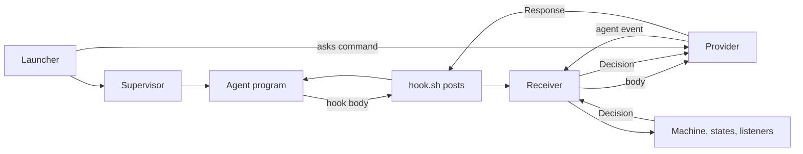

# One provider boundary for Claude Code and Codex

**Proposal for review, 20 October 2026. Written by Marco Polo; reviewed and revised by Dr. Turing
against development `e8c4da7c9b` (section 11). No production code is changed by it.**

## Recommendation

Make `Provider` a real abstract class: the one place that knows an agent program. Everything the
journal knows about Claude Code or Codex (how to start it, resume it, run it as a worker, wire its
hooks, read its hook bodies and transcripts, report its status) is an abstract method on it,
implemented once in `claude.py` and once in `codex.py`. Today that knowledge leaks into the
launcher, the menu answers, the worker runner, the MCP writer, the profile renderer, `Where`, and
a dozen feature listeners that match raw tool names such as `"Bash"` and `"Agent"`. Pull each
leak back into the provider, at its source.

Keep the route that works: CLI, hooks, the shell bridge and the supervisor. The supervisor stays a
process host that knows no provider. The engine, its states and the existing agent events stay the
journal's only vocabulary: a provider decodes its hooks straight into those events, never into a
second set of events that a mapper then translates.

Add one check the journal lacks: a launch names itself, and the session that starts must carry
that name back from its hook. A session that does not is reported, not quietly taken as the
environment's agent.

Neither provider is certified by this document. A flag in `--help`, a hook in a settings file and
a passing signed-in terminal test are three different facts, and section 6 says which test proves
which.

## 1. Baseline and evidence

### 1.1 What was actually inspected

Marco Polo's worker began on development commit `b7607f3e5a17b673c45be8b37f040ef62b08bdf2` in
`worker/34-Marco-Polo`, reset its branch to local `main` (`0edb1f3a09`, version `4.4.9`) and
traced the source there. The review in section 11 checked every code claim again on development
`e8c4da7c9b`, which is 42 commits past that main; line numbers below are development's, with
main's in brackets where they differ.

| Check | Observation on this machine | Meaning |
| --- | --- | --- |
| Working directory | `.journal/worktrees/34-Marco-Polo` | A linked worker worktree with no `.journal` of its own. |
| Command resolution | `~/.local/bin/journal` walks up to the project's `.journal/src/journal.sh` | A command run in a worktree reaches the project's journal. |
| Installed source | `.journal/src/journal/version.py`: `4.4.9`; `.journal/src/commit`: `b7607f3e…` | Installed development code differs from main under the same version number. |
| Running server | Port file `8420`; `GET /journal/updates` reports installed `4.4.9`, latest `b7607f3` | Only reads were sent; no scratch journal used 8420–8429. |
| Shell routing | `JOURNAL_ROOT` set; `JOURNAL_ENV=development`; `JOURNAL_SESSION` absent | The shell names its environment and no journal session. |
| Agent marker | `CODEX_THREAD_ID=01a15ae8-…` | The worker's own Codex thread, not the development agent's session. |
| Attribution | `journal task log 966 …` created task log `529` in environment `5`, `created_by=agent:01a15ae8-…` | A worker's command is attributed to the worker's thread. |
| Registration | No agent row for that thread; worker `34` dispatched in environment `5` | A worker's commands are attributed without the worker being an agent row, as designed. |
| Installed programs | `claude --version`: `2.1.296`; `codex --version`: `codex-cli 0.163.0` | These binaries are the compatibility targets. |

No secret store, credential file or MCP key was read. The only production requests were reads;
the task log and report used the worker's own journal commands.

### 1.2 Historical evidence, with its limits

- Task **966** asks for real Codex tests of stopping and holds after reports of a Codex agent
  stopping early. Its task log `519` says the attempt ran against main while the intended
  development process ran separately, so it cannot say whether a correctly routed stop refusal
  works.
- Task **968** records the root, environment and session mismatch and its repair in **4.4.6**,
  commit [`70cf41d7d4`](https://github.com/jessegall/agent-journal/commit/70cf41d7d4a551d5625effc32d224ec95b848c4e):
  interactive Codex runs with `--no-daemon`, and command attribution reads `CODEX_THREAD_ID` and
  `CODEX_CI`. Those are reports, not tests rerun for this document.
- The fix is still in the code: `launcher/launch.py:29` (`LOCAL`) and `support/where.py:28–30`.
  An old symptom does not show routing is broken today, and keeping the fix does not show every
  provider feature works.

### 1.3 Local terminal observations

Both installed programs were opened in a scratch folder, each with an empty configuration folder,
and no model was asked anything.

| Probe | Observed result | What it proves |
| --- | --- | --- |
| Codex `--no-daemon --no-alt-screen -C <scratch>` | Showed version `0.163.0` and its sign-in choices; Ctrl-C ended it with exit `0` | It starts and exits at the sign-in screen. Nothing about hooks. |
| Claude `--safe-mode --setting-sources '' --strict-mcp-config --mcp-config '{"mcpServers":{}}'` | Showed the first-run theme menu; Ctrl-C did not end it in time; SIGTERM ended it with `143` | First-run screen and bounded cleanup. Safe mode loads no journal hooks. |
| Installed help | Codex lists `--no-daemon`, a hook-trust bypass, `exec --json` and app-server schema output; Claude lists safe mode and `--session-id` | The flags exist; not what they do. |

A first probe that did not answer the terminal's colour queries stalled. That is a lesson for the
test harness, not a fault in either program; `src/supervisor/terminal.py:117` already drains the
terminal while it waits for an exit, and the harness reuses it.

**No signed-in journal run of either provider was made. Every live claim below is unverified.**

## 2. Current architecture and where the two providers drift apart

### 2.1 Where provider knowledge lives today

Each row is a thing the journal must know about a provider, where it is known today, and where it
belongs. "Provider" means an abstract method on `Provider`, implemented in `claude.py` and
`codex.py`; "shared" means the journal's own code, which asks the provider and never names it.

| What must be known | Known today in | Belongs in |
| --- | --- | --- |
| The interactive command: skip-prompt flags, status settings, no-daemon, sandbox network | `launcher/launch.py:26–31` maps keyed by `"claude"`/`"codex"`, `agent_command:105–109` | Provider |
| The resume arguments | `launch.py:26` `RESUME` **and** `Provider.resume` (`claude.py:96`, `codex.py:86`), used by `mcp_installing.py:88` | Provider, once; `RESUME` deleted |
| The shell runner variable | `launch.py:117` sets `CLAUDE_CODE_SHELL_PREFIX` for both providers | Provider (Claude only) |
| The settings files that hold other hooks | `launcher/support/other_hooks.py:7` `FILES` keyed by name, beside `Provider.home/settings_file/other_settings` | Provider, once |
| Whether hooks are trusted | `Codex.hooks_trusted:29` [main 19], a substring search of `~/.codex/config.toml` | Provider, returning a readiness value instead of a bool |
| MCP servers in the program's config | `features/mcp/support/provider_config.py:14–23` writes both files | Provider, merging only its own keys |
| Profile text | `Profile.claude_text` / `Profile.codex_text` (`features/profiles/support/profile.py:20,23`) | Provider renders one shared profile |
| The worker command and how its result is read | `Provider.worker_command`, `worker_outcome` | Provider (already) |
| Which variables a worker must not inherit | `WorkerRunner.NOT_HANDED` (`worker_runner.py:29`), three names | Provider names its own markers; shared runner strips them |
| Which variable names the agent's session in a shell | `Where.from_environ` (`support/where.py:28–30`) reads `CLAUDECODE`, `CODEX_THREAD_ID`, `CODEX_SANDBOX`, `CODEX_CI` | Provider |
| The cheap model a menu question is asked with | `MenuAnswers.ASKING_MODEL = {"claude": "haiku"}` (`engine/support/menu_answers.py:18`) | Provider |
| Hook kinds and the answer's JSON shape | `Provider.hook_kinds`, `Provider.answer:149` [main 147] | Provider (already) |
| What a tool call does: shell line, file edit, read, skill, subagent | `Provider.writes/read_paths/written_paths/skill_loaded`, **and** raw-name checks in features: `"Bash"` in `tool_starting.py:19`, `tool_finished.py:23`, five listeners and three controllers; `("Agent", "Task")` in `subagents.py:56`, `mark_subagents.py:15`, `offer_known_subagent.py:20`, `count_profile_use.py:16` | Provider decodes a typed operation; features read the operation |
| Transcript files, turns, texts, other sessions' messages | `Provider.transcript`, `turns_in`, `texts_in`, `crossed_in`, `subagent_transcript`, `latest_session` | Provider (already) |
| Context, model, effort, rate windows | `support/context_file.py`, Claude's status line only | Provider (Claude reads it; Codex says unknown) |
| Model, effort and context controls | `Provider.controls` | Provider (already) |
| Menus in the terminal | `providers/support/menu.py` (shared shape, some Claude-only phrases such as "switch model") and `MenuWatcher` | Shared shape; provider-only phrases on the provider |
| Delivering lines, confirming them, retyping lost ones | `SupervisorLink.type`, `TypedLines`, `ConfirmTyped`, `RetypeLost` | Shared (already); both providers confirm by `UserPromptSubmit` |
| Processes, the terminal, restarts | `src/supervisor` | Supervisor (already); it knows no provider |

### 2.2 Defects found in the code

These follow from reading the code; none was reproduced in a signed-in run.

| Finding | Where it starts and what it does | Fix at the source |
| --- | --- | --- |
| The contract is not enforced | `Provider.transcript:51`, `turns_in:64`, `resume:139` and `worker_command:141–143` have `...` bodies, and `Provider` is no `ABC`; `latest_session`, `thoughts_this_turn`, `texts_in`, `crossed_in` and `subagent_transcript` default to empty, and `hooks_trusted` to `True` | Make `Provider` an `ABC` with `@abstractmethod`; an incomplete provider cannot be built |
| Provider knowledge outside `providers/` | The rows of 2.1 marked "known today in" anywhere but a provider file | Move each into the provider; delete the maps |
| Features match raw tool names | Ten places test `tool == "Bash"`; four test `("Agent", "Task")`. Codex's shell hooks arrive as `Bash` with a string `command` [O13], so the shell checks hold for hooks today. No journal code recognises a Codex subagent dispatch by any other name; if Codex's hook names it `spawn_agent`, as its source reads [O9, O13], the subagent marks and the subagent limit never see a Codex subagent (unverified live) | `ToolStarting` and `ToolFinished` carry an `Operation` the provider decoded; features read `ShellLine` or `SubagentDispatch`, never a name |
| A tool's input is read one way | `ToolInput.from_json` (`support/tool_input.py:15`) reads `command`, not `cmd`, and turns a list into its Python text | The provider's `operation` decodes each shape it knows; a list becomes a shell-quoted line |
| Trust is a substring | `Codex.hooks_trusted:29–33` looks for `[hooks.state."<file>:session_start` in the user's config; it cannot tell disabled, changed-since-trusted or partly trusted hooks | `hooks_ready` returns one of a few named states; a test covers each |
| Status is Claude's | `ContextFile` reads Claude's status-line file; Codex's controls are empty, its thoughts `[]` | `Provider.status` returns a status whose unknown parts say unknown, never zero |
| Codex's transcript is found by a global search | `Codex.transcript:35–42` globs `~/.codex/sessions/**` for the session, ignoring the project (it keeps a found file since development `ec9d3a8fd8`) | Keep; prefer the path a hook body names (`transcript_path`) when there is one (unverified for Codex) |
| Codex's reader keeps no channel | `CodexRow` has no channel; `Codex.texts_in:82–84` takes every assistant message as a reply | Read the channel Codex writes, if it writes one (unverified); only a final answer counts as a reply |
| A Codex worker's session is read from prose | `Codex.worker_command:89–92` runs `codex exec` without `--json`; `worker_outcome:94–96` regexes `session id:` from what it printed. Development adds `latest_session:44–49`, which finds the newest rollout whose first line names the project | Run `exec --json`; read the session from its first event and the report from its last [O4] |
| MCP writes replace a user's Codex settings | `ProviderConfig.write:20–22` writes the project's whole `.codex/config.toml` from the MCP servers alone | Merge: replace only the `[mcp_servers.*]` tables the journal owns |
| A worker inherits its parent's markers | `NOT_HANDED` removes `AGENT_JOURNAL_ACTIVE`, `JOURNAL_SESSION`, `CLAUDE_CODE_SHELL_PREFIX`; `CODEX_THREAD_ID` and `CLAUDECODE` are inherited. A Claude worker started under a Codex agent would read the parent's `CODEX_THREAD_ID` in `Where.from_environ` and have its commands attributed to the parent (from the code; not reproduced). Development's `JOURNAL_ACTOR=worker-agent` silences the worker's hooks but not this | Each provider names its markers; the runner strips all of them |
| A lost hook is silent | `hook.sh:21–30`: no server, a curl failure or any status but 200 and 409 lets the event through with no trace. A guard that raises is not silent: `Receiver._guarded:74–82` saves a `guard_failed` entry, shows a card and tells the agent | Keep fail-open; have the server notice the gap (a tool finished with no start recorded) and show a card |

`Provider.answer:149`'s docstring says "a stop already refused once is let through", but its body
does not, and `tests/test_features.py:2466` expects the second stop to be held as well ("there is
no repeated-stop escape"). The docstring is stale; it is not the cause of early stopping, and the
shared answer must not be changed for Codex without a wire-level reproduction.

### 2.3 Explanations that still need a live run

An agent that stops early may have disabled or untrusted hooks, a session routed to the wrong
environment, stop feedback read as a new prompt, a tool shape the journal does not recognise,
the provider's own limit on continuations, or another hook that wins. Task 966 does not tell them
apart. The live stop tests in 6.5 do.

Claude's changelog shows later fixes to hook and session-end behaviour (`2.1.300`, SessionEnd
while background work runs), after the installed `2.1.296` [C8]. That is a version risk, not a
reproduced fault.

## 3. Provider comparison from their documentation

Sources were read **2026-10-20** by Marco Polo. This section is the providers' documentation and
Codex's source, not the journal's code; the review did not re-read the sources and marks every row
unverified. "Local" means the probes in 1.3.

| Concern | Claude Code | Codex | What the journal does with it |
| --- | --- | --- | --- |
| Hook events | Start, prompt, tool, stop, compact, subagent, end; MessageDisplay [C1] | Twelve events at `rust-v0.163.0`, including PostCompact and Interrupt, no MessageDisplay [O8] | `hook_kinds` per provider (already); a missing hook is never pretended |
| Holding a tool | PreToolUse deny, or exit 2, stops the call [C1] | Deny works for local tools; shell hooks arrive as `Bash`, patch and subagent tools keep their own names [O9, O13] | Decode to an operation first; check the side effect is absent |
| Refusing a stop | The block reason becomes the next instruction [C1] | The block reason becomes a continuation prompt; any stop hook's `continue:false` wins [O10] | Never send `continue:false`; record the continuation as the journal's, not the user's |
| What a hook cannot hold | A post-tool hook cannot undo; an async hook cannot hold [C1] | Hosted tools may skip local hooks; `write_stdin` continues a running command [O1] | Each operation says whether it can be held |
| Trust | Settings sources and safe mode decide loading [C2, C3] | Project trust and a per-definition hash; failing hooks may let tools run [O1] | `hooks_ready`; a hooks file is not proof |
| Headless | `claude -p`, JSON or stream-json [C4] | `codex exec --json` prints thread, turn and item events [O4, O12] | Workers read structured output |
| Resume and compaction | `--resume` continues a conversation [C5] | Start sources include resume, compact, clear and fork [O1]; 0.163.0 changed what a resume restores [O7] | Check binding, hooks and status after each start |
| Subagents | Subagent definitions with their own tools and background runs [C6] | Subagent threads with roles and limits [O6] | One `SubagentDispatch` operation; journal workers stay separate |
| Transcripts | What the program writes [C5] | Hook transcript format is not stable [O1, O3] | Readers per provider; unknown is unknown |
| Terminal | Setup menus [C7]; local first-run screen needed SIGTERM | Local sign-in screen exited on Ctrl-C [O3] | Recognise a screen before pressing anything |
| Alternatives | CLI streaming; SDK callbacks are not the CLI [C4] | An app-server with threads, turns, interrupts and token use [O5] | Not needed for this work (section 9) |

## 4. Who owns what



**The provider** knows its program: its commands and flags, its settings files and their merge,
its trust, its hook bodies and answers, its tool shapes, its transcript files, its status and its
terminal phrases. A Codex-only workaround lives in `codex.py`, with a test.

**The shared journal** knows everything else and never names a provider: environments, sessions,
the launch check, tasks, the stop decision, workers and their worktrees, subagent limits,
delivery of lines, replies, faults. It keeps the `Receiver`, the engine, the repositories and the
blocking-then-deferred order as they are. A guard that raises still lets the event through and
says so.

**The supervisor** owns the terminal, processes, signals, restarts and clean exit. It knows no
provider, task or hook. It keeps its convention of placing the resume arguments right after the
program (`terminal.py:32`), which both providers' resume forms fit.

### Rules that hold throughout

1. Shared code never compares a provider's name. It may ask a provider, list providers or show a
   name.
2. A launch is named. The launcher writes a launch id into the launch file and the agent's
   environment; the hook and the `journal` shim send it back; the server takes a session as the
   environment's agent only when the id names that environment's launch. A session without it is
   recorded and reported, never taken as main or as the environment's newest agent.
3. A tool call is an operation the provider decoded, with the provider's call id when the hook
   carries one. Features read the operation.
4. A hold is a refusal the agent got before the tool ran. A 409 that never reached the agent is
   not a hold, and the record says so.
5. A refused stop names what to do next. `stop_hook_active` is a fact on `Idle`, never permission
   to drop work.
6. A config write keeps what the journal did not write, and the journal never reads credentials.

## 5. The contract

The code below is a proposal. Each class and value is a file of its own under `providers/` or
`providers/support/`, as the rest of the package does.

### 5.1 The values a provider returns

```python
@dataclass(frozen=True)
class ShellLine:
    """A shell command the agent is about to run, as one line."""

    command: str


@dataclass(frozen=True)
class FileEdit:
    """A change to files: the paths it writes."""

    paths: tuple[str, ...]


@dataclass(frozen=True)
class FileRead:
    path: str


@dataclass(frozen=True)
class SkillLoad:
    skill: str


@dataclass(frozen=True)
class SubagentDispatch:
    """The agent starting one of its program's own subagents."""

    kind: str
    model: str
    brief: str


@dataclass(frozen=True)
class OtherTool:
    name: str


Operation = ShellLine | FileEdit | FileRead | SkillLoad | SubagentDispatch | OtherTool


class HooksReady(StrEnum):
    READY = "ready"
    NOT_WIRED = "not wired"
    NOT_TRUSTED = "not trusted"
    CHANGED_SINCE_TRUSTED = "changed since trusted"


class Capability(StrEnum):
    """What the viewer may offer for an agent of this program."""

    THOUGHTS = "thoughts"
    CONTEXT_STATUS = "context status"
    LIVE_TEXT = "live text"
    SUBAGENT_TRANSCRIPTS = "subagent transcripts"
    MODEL_CONTROLS = "model controls"


@dataclass(frozen=True)
class AgentStatus:
    """What the program last reported about a session; an empty part is unknown, never zero."""

    model: str
    effort: str
    context: float | None
    read_at: float


@dataclass(frozen=True)
class WorkerOutcome:
    report: str
    session: str
```

`ShellLine`, `FileEdit` and the rest are frozen and pure: `ShellLine.writes()` asks the existing
`Writes`, `ShellLine.reads()` the existing `Reads`. A Codex command given as a list becomes one
`ShellLine` by `shlex.join`. A tool the provider does not know is `OtherTool`, and a feature that
cares about writes treats it as one that may write.

`ToolStarting` and `ToolFinished` gain `operation: Operation` and `call: str`, the provider's call
id, empty when the hook carries none. Their `tool` and `input` stay for the record. Their `writes`
field and `words` property read the operation. No other new agent events are added; one is added
later only when a feature needs a moment no existing event means, such as Codex's `Interrupt`.

### 5.2 The abstract provider

```python
class Provider(ABC):
    """One agent program, Claude Code or Codex: everything the journal knows about it, and nowhere else."""

    name: ClassVar[str]
    home: ClassVar[str]
    settings_file: ClassVar[str]
    other_settings: ClassVar[tuple[str, ...]]
    hook_kinds: ClassVar[tuple[HookKind, ...]]
    skip_prompts: ClassVar[tuple[str, ...]]
    session_variable: ClassVar[str]
    """The variable the program sets in its shell to its session's id, or empty when it sets none."""
    inherited_markers: ClassVar[tuple[str, ...]]
    """The variables the program sets in its shell, which a worker must not inherit."""
    asking_model: ClassVar[str]
    capabilities: ClassVar[frozenset[Capability]]
    controls: ClassVar[dict]

    @abstractmethod
    def interactive_command(self, choice: Choice, status: StatusLine, args: tuple[str, ...]) -> list[str]: ...

    @abstractmethod
    def launch_environment(self, runner: Path) -> dict[str, str]: ...

    @abstractmethod
    def resume(self, session: str) -> tuple[str, ...]: ...

    @abstractmethod
    def worker_command(self, brief: str, model: str, resume: str) -> list[str]: ...

    @abstractmethod
    def worker_outcome(self, out: str, err: str) -> WorkerOutcome: ...

    @abstractmethod
    def hooks_ready(self, project: Path) -> HooksReady: ...

    @abstractmethod
    def write_mcp(self, project: Path, servers: list[McpServer]) -> Path: ...

    @abstractmethod
    def profile_text(self, profile: Profile, model: str) -> str: ...

    @abstractmethod
    def operation(self, tool: str, input: dict) -> Operation: ...

    @abstractmethod
    def transcript(self, project: Path, session: str) -> Path | None: ...

    @abstractmethod
    def turns_in(self, rows: Iterator[tuple[int, dict]]) -> list[Turn]: ...

    @abstractmethod
    def texts_in(self, line: dict) -> list[str]: ...

    @abstractmethod
    def status(self, session: str) -> AgentStatus: ...

    def answer(self, hook: Hook, decision: Decision) -> Response: ...
    def wire_hooks(self, project: Path, script: Path, command: str) -> Path: ...
```

The last two stay concrete in the base, because both programs take the same command-hook JSON and
the same settings shape today (`provider.py:149–176`). The shared transcript readers
(`json_lines`, `texts_written`, `last_line_start`) stay concrete in the base too. Every method
whose base today returns an empty answer becomes abstract, so a provider that cannot answer says
so in its own file. `thoughts_this_turn`, `crossed_in`, `subagent_transcript` and `latest_session`
become abstract as well; Codex answers them with nothing, and `capabilities` tells the viewer not
to offer them.

Two methods, not one with a mode: `interactive_command` and `worker_command`. A provider's native
parsers stay small values of their own file (`ClaudeRow`, `ClaudeBlock`, `CodexRow`, as today). If
a provider file grows past reading at a glance, it builds per-concern support classes in its
constructor, and callers still ask only the provider.

### 5.3 Launching

```python
class Codex(Provider):
    name = "codex"
    skip_prompts = ("--dangerously-bypass-approvals-and-sandbox",)
    session_variable = "CODEX_THREAD_ID"
    inherited_markers = ("CODEX_THREAD_ID", "CODEX_SANDBOX", "CODEX_CI")

    def interactive_command(self, choice: Choice, status: StatusLine, args: tuple[str, ...]) -> list[str]:
        skip = [flag for flag in self.skip_prompts if choice.skip_prompts and flag not in args]
        reach = [] if choice.skip_prompts else ["-c", "sandbox_workspace_write.network_access=true"]
        return ["codex", "--no-daemon", *skip, *reach, *args]

    def worker_command(self, brief: str, model: str, resume: str) -> list[str]:
        resumed = ["resume", resume] if resume else []
        chosen = ["-m", model] if model else []
        return ["codex", "exec", *resumed, "--json", *self.skip_prompts, *chosen, brief]
```

`Launch.agent_command` becomes `provider.interactive_command(choice, status, self.args)`, and
`Launch.environ` adds `provider.launch_environment(runner)`; `RESUME`, `SKIP`, `STATUS`, `LOCAL`
and `REACH` go. Claude's `launch_environment` sets `CLAUDE_CODE_SHELL_PREFIX`; Codex's sets none.
The interactive `--no-daemon` stays in Codex's command with the 4.4.6 regression test; it is not
carried into `exec` [O12]. A Codex worker reads its session from the first `--json` event and its
report from the last, and an error event fails the run even when the exit code is 0.

`WorkerRunner` strips `inherited_markers` of every provider, not only its own, so a Claude worker
under a Codex agent does not carry the parent's thread. `Where.from_environ` reads the session
from `JOURNAL_SESSION`, then from each provider's `session_variable`.

The launch file at `runtime/launches/<environment>.json` already exists and the engine already
reads it (`engine/support/launch_files.py`). It gains a `launch` id, which the launcher also puts
in the agent's environment as `JOURNAL_LAUNCH`. `hook.sh` sends it as a header, as it sends
`X-Journal-Env`; the server compares it on `SessionStart`. This is the whole binding: no
session-key type, no generation counter. One session per environment already holds.

### 5.4 Two hook bodies, one event

```json
{"hook_event_name": "PreToolUse", "session_id": "claude-session", "tool_use_id": "call-7",
 "tool_name": "Bash", "tool_input": {"command": "printf ready > ready.txt"}}
```

```json
{"hook_event_name": "PreToolUse", "session_id": "codex-thread", "turn_id": "turn-3", "tool_use_id": "call-7",
 "tool_name": "Bash", "tool_input": {"command": "printf ready > ready.txt"}}
```

These are representative; the installed forms must be captured from real runs into the test
fixtures. Codex rewrites its `exec_command` call's `cmd` into this `Bash`/`command` form for hooks
[O13]; its patch and subagent tools keep their own names [O9, O13]. Both bodies become the same
event through the one table that exists, `Translation.EVENTS` (`hooks/translation.py:25–36`):

```python
HookKind.PRE_TOOL_USE: lambda hook, provider: ToolStarting(
    tool=hook.tool, input=hook.input, call=hook.call, operation=provider.operation(hook.tool, hook.input)),
```

Both decode to `ToolStarting(operation=ShellLine("printf ready > ready.txt"), call="call-7")`. A
subagent's hook keeps the agent's session and its own `agent_id` on the event's `subagent`, as
today; it is never registered as an agent of its own.

### 5.5 Holding a tool and refusing a stop

`Provider.answer` already shapes both answers (`provider.py:149–160`): a refusal on a tool is 409,
which `hook.sh` turns into exit 2 with the reason on stderr; a refusal on Stop is
`{"decision": "block", "reason": …}` with status 200. Both programs accept both forms [C1, O9,
O10], so the answer stays shared. A provider overrides it only for a shape its program differs on,
with a captured body proving the difference. Neither form sends `continue:false`, which on a Codex
stop hook ends the turn instead of continuing it [O1, O10].

Refusing a stop does not keep the process alive. A user's exit, a signal or a crash ends it;
SessionEnd is advisory [C1, O1]. The journal records what happened. Claude limits how many times
in a row a stop is refused [C1]; the journal does not try to raise that limit, and the live tests
measure it.

The shell bridge keeps posting and printing. Moving the JSON for the 409 reason out of `sed` and
into the server (the server prints the reason; the script copies it) is a small, separate fix.

### 5.6 What a provider cannot do

A capability a provider lacks is missing from its `capabilities`, and the viewer does not offer
it. A method it cannot answer returns its empty value in its own file, where the reason is
written. Nothing in the shared code fills in a missing answer, and a test lists each provider's
capabilities so a change to them is seen.

## 6. Proof

### 6.1 Three layers

| Layer | What runs | What it proves | When |
| --- | --- | --- | --- |
| Default suite | Both real providers against a real scratch server, with hook bodies captured from real runs | Decoding, answers, operations, config merges, the launch check, readiness, worker commands | Every change; a dozen seconds; no model, no network |
| Process runs | The real supervisor with a shell script as the agent (`tests/supervisor_processes_run.py`) | Terminal, restart with resume arguments, clean exit | Before a change to `src/supervisor` |
| Live runs | Each installed, signed-in program in a scratch journal | Hooks fire, holds hold, stops lead to work, workers and subagents report | Before a provider version is called supported |

The default suite keeps its existing coverage, including
`test_the_session_start_requires_the_journal_skill_and_reading_it_lifts_the_hold`,
`test_every_session_start_reads_what_is_in_flight_before_any_other_write` and
`test_the_three_holds_are_answered_under_codex_as_the_frozen_records_show` in
`tests/test_features.py`, the routing tests in `tests/test_cli.py` and `tests/test_supervisor.py`,
and the Claude and Codex replay pairs in `tests/replays/`. They prove the journal's side; they are
not live tests.

### 6.2 Default-suite cases

New cases go into the existing files, one per behaviour, parameterised over both providers:

| File | Cases |
| --- | --- |
| `tests/test_hooks.py` | Every hook kind each provider declares decodes into its agent event; a Codex `cmd` list is one `ShellLine`; `apply_patch` adding, changing and deleting files is a `FileEdit` of each path; a Claude `Agent` call and a Codex subagent call are both `SubagentDispatch`; an unknown tool is `OtherTool`; a hold answers 409 and a refused stop the block JSON for both |
| `tests/test_setup.py` | An incomplete provider cannot be built; MCP servers written into a Codex `config.toml` with other tables keep those tables; each `HooksReady` state from a prepared config |
| `tests/test_cli.py` | A worker's environment carries no provider's markers; a session named by `JOURNAL_SESSION` wins over a provider variable; a hook whose launch id names another environment's launch is reported and registers no agent |
| `tests/test_hooks.py` | A Codex subagent dispatch is paired and counted by `Subagents` like a Claude one |

Hook bodies come from sanitised real captures, with the program's version beside each.

### 6.3 The live harness

One file, `tests/providers_live_run.py`, whose first line says it starts the installed Claude Code
and Codex, needs them signed in and needs the network, so it is not in the default run. It reuses
the existing process harness rather than a second one.

Each run makes a fresh git repository and `.journal`, installs the source under test, takes a free
port above 20000 (never 8420–8429) and checks the server it reached is its own before any request.
It strips every provider's markers and journal variables from the environment and sets its own.
It keeps the real home folder and uses each program's own config-folder option and a separate
test sign-in. It records the commit, both program versions and the hook config's hash, and no
credential.

It answers the terminal's colour and cursor queries, drains the terminal throughout, waits for a
`SessionStart` carrying its launch id before sending any work, and ends with a graceful exit, then
SIGTERM, then SIGKILL of its own process group, checking nothing it started is left.

Seeding goes through the repositories as `Actor.system()`; behaviour under test goes through the
agent's own `journal` commands. Nothing posts to the viewer's API.

### 6.4 Live cases

Each case runs for both providers.

| Test | What it must observe |
| --- | --- |
| `test_a_launched_agent_starts_bound_to_its_environment` | `SessionStart` from the real launch with its launch id; the agent's own shell command lands in the same environment and session; nothing lands in another environment |
| `test_untrusted_hooks_are_reported_not_ready` | With Codex's trust withheld and Claude in safe mode, `hooks_ready` says so and the journal claims no hold |
| `test_the_first_write_is_held_until_the_skill_is_read` | The first write is refused before it runs and its file is absent; after the skill is read and the look taken, the write lands |
| `test_a_held_shell_command_never_runs` | A command that would write a sentinel file is refused; the file never appears; the refusal names that call |
| `test_a_refused_stop_leads_to_work` | See 6.5 |
| `test_a_worker_reports_and_resumes_with_its_memory` | A headless worker's session is read from its output; its report is filed; its commands are the worker's, not its parent's; a second job resumes it and it recalls a word from the first |
| `test_a_subagent_is_marked_and_settled` | A native subagent is marked when dispatched and settled when done; one past the limit is refused |
| `test_a_restarted_agent_resumes_its_conversation` | A restart through the supervisor with the resume arguments comes back on the same session and recalls a word; this also checks `codex resume <id> --no-daemon` is accepted in that order |

If the model declines to try the tool a case needs, the trial proves nothing and is reported as
inconclusive, never as passed.

### 6.5 Stop tests: a refusal must lead to work

A refused stop passes only when this whole chain is observed:

`Stop → refusal with a next step → the agent continues → a real change (a task started, a file written, a command run) → the debt cleared or an allowed wait → the next stop let through`.

Saying "I will continue", or stopping again with nothing done, fails.

| State at the stop | What must happen |
| --- | --- |
| Open task, none in hand | Stop refused; the agent starts the task and does its step; the task and its file show it |
| Task in hand | Stop refused while work remains; the agent finishes it; the next stop is let through |
| Paused by the user | Stop let through quietly; no task started, no further nudge |
| Waiting on something outside | Stop let through while it is unmet; when it is met, one nudge reaches that session and the agent acts |
| Stopped again with no tool between | Refused each time; the provider's own limit is recorded when it is reached |
| Another stop hook in the scratch config returns `continue:false` (Codex) | What the program actually did is recorded; the journal does not claim its refusal worked |
| User interrupts or exits | Let through and recorded; no refusal tries to undo it |

```python
def test_a_refused_stop_leads_to_work(provider, live_journal):
    run = live_journal.signed_in(provider)
    session = run.launch(environment="development")
    task = run.seed_open_task("Write the word in continued.txt, then finish this task")
    run.say(session, "Give a short status and stop.")
    refusal = run.wait_for_stop_refusal(session)
    run.wait_for_task_started_by_agent(task, after=refusal)
    assert (run.root / "continued.txt").read_text() == run.word_of(task)
    run.wait_for_task_done_by_agent(task)
    assert run.next_stop_let_through(session)
```

### 6.6 Limits and what is left to decide

Every wait has a deadline: about 60 seconds to start, 90 for a tool or a continuation, 180 for a
worker or subagent, 5 minutes a case. A timed-out case keeps what it saw and fails. Where the live
runs run (a developer's machine only, or a protected runner with test accounts), what they may
cost and who owns the test sign-ins are decisions for the user (section 9).

## 7. Migration

Each stage is one reviewable change with its tests. It does not mix with the stack-of-states work
on development; if that lands first, the stages follow its event and listener shapes.

| Stage | Change | Done when |
| --- | --- | --- |
| 0. Live baseline | Write `tests/providers_live_run.py` and capture real hook bodies of both programs into fixtures; change no behaviour | Every case of 6.4 has a recorded result, failures named |
| 1. Abstract provider | Make `Provider` an `ABC`; mark the methods of 5.2 abstract; give Codex its explicit empty answers and `capabilities` | Both providers build; an incomplete one cannot |
| 2. Launching | Move `RESUME`, `SKIP`, `STATUS`, `LOCAL`, `REACH`, the shell-runner variable, `OtherHooks.FILES`, `ASKING_MODEL`, `NOT_HANDED` and `Where`'s variables into the providers; add the launch id; Codex workers on `exec --json` | The 4.4.6 tests and the new launch, worker and binding cases pass |
| 3. Operations | Add `Provider.operation` and the `Operation` values; `ToolStarting`/`ToolFinished` carry them; replace every `"Bash"` and `("Agent", "Task")` check in features, events and controllers; retire `writes`, `read_paths`, `written_paths`, `skill_loaded` and `ToolInput` | No shared file compares a tool's name; Codex subagents count against the limit |
| 4. Files and status | `write_mcp` merges; `profile_text` replaces `Profile.claude_text/codex_text`; `hooks_ready` replaces `hooks_trusted`; `status` replaces direct `ContextFile` use | Codex's own config tables survive an MCP change; the viewer offers only a provider's capabilities |
| 5. Clean-up | Delete what the stages replaced; a custom rule flags a provider name compared outside `providers/` | The rule runs clean and the live cases pass |

The rule in stage 5 is a custom rule in `.commandments/custom/`, like the one that flags the state
machine outside the engine: it flags `== "claude"`, `== "codex"`, a dict keyed by
provider names, and a tool-name comparison outside `providers/`. Showing a name is allowed.

## 8. Acceptance

The change is accepted when:

1. `Provider` is abstract and both providers implement every abstract method; a missing answer is
   written in the provider's own file.
2. No shared file compares a provider's name or a tool's raw name; the stage-5 rule says so.
3. A real launch of each program shows the hook, its shell and its `journal` commands in the same
   environment and session, and a session with the wrong launch id is reported.
4. The live cases of 6.4 and the stop table of 6.5 pass for both pinned program versions; a held
   call left no side effect.
5. An MCP change keeps a user's own Codex config tables; a worker carries none of its parent's
   markers.
6. The default suite still runs in about a dozen seconds.

## 9. Decisions for the user

1. **One abstract provider.** Approve `Provider` as an `ABC` holding all provider knowledge, as in
   section 5, rather than the three collaborators of the first draft (see 11.3).
2. **The launch check.** Approve the launch id carried from launcher to hook and shim, and
   reporting a session without it rather than refusing its tools. Refusing would be a separate
   decision.
3. **Where live runs run and what they cost.** A developer's machine only, or also a protected
   runner with test sign-ins; who owns those sign-ins; whether a release waits on them.
4. **Which program versions are supported.** Pin a minimum version of each, and decide whether an
   upgrade waits for the live cases.
5. **Codex's app-server.** Not needed for any of this. Decide later whether it is worth a look for
   delivery confirmation or status, once the CLI route is proven.

This document adds no code. No suite was run and no signed-in result is claimed.

## 10. Primary sources

All links below were accessed **2026-10-20** by Marco Polo. Public documentation is mutable. Codex
implementation references are pinned to the installed version's source tag; Claude's official
repository supplies release notes, not the implementation of its installed binary.

| ID | Primary source | Relevance / evidence boundary |
| --- | --- | --- |
| O1 | [Codex hooks](https://learn.chatgpt.com/docs/hooks) (the official `developers.openai.com/codex/hooks` URL redirects here) | Event input/output, tool coverage and aliases, trust, failure/async behavior, stop/interrupt/end, compaction. Documentation, not local live proof. |
| O2 | [Codex configuration reference](https://learn.chatgpt.com/docs/config-file/config-reference) | Configuration layers, shell environment policy, credential-store references, provider settings. No local user config/keys were read. |
| O3 | [Codex developer/CLI commands](https://learn.chatgpt.com/docs/developer-commands?surface=cli) | Interactive/noninteractive command surfaces, local/remote behavior, history migration/resume and flags. Installed `--help` independently checked. |
| O4 | [Codex noninteractive mode](https://learn.chatgpt.com/docs/non-interactive-mode) | `exec --json` thread/turn/item events, stdout/stderr and final-message output, isolation flags and CI behavior. |
| O5 | [Codex app-server documentation](https://learn.chatgpt.com/docs/app-server) and [installed-version app-server README](https://github.com/openai/codex/blob/rust-v0.163.0/codex-rs/app-server/README.md) | Structured transport, threads, turns, steering, interrupts, status. Alternative driver research; not attributed to the CLI. |
| O6 | [Codex subagent configuration](https://learn.chatgpt.com/docs/agent-configuration/subagents) | Native subagent roles/configuration and lifecycle. Journal workers remain a separate concern. |
| O7 | [Codex 0.163.0 release](https://github.com/openai/codex/releases/tag/rust-v0.163.0) | Published 2026-10-15; changes include steering/nested cancellation, daemon restart, resume permissions/network restoration, child-held output pipe completion. |
| O8 | [Codex installed-version hook event registry](https://github.com/openai/codex/blob/rust-v0.163.0/codex-rs/hooks/src/lib.rs) | Twelve declared hook events and supported matcher categories. |
| O9 | [Codex installed-version PreToolUse implementation/tests](https://github.com/openai/codex/blob/rust-v0.163.0/codex-rs/hooks/src/events/pre_tool_use.rs) | Canonical payload name retained independently of matcher aliases, normalized command payload serialization, deny/rewrite handling. |
| O10 | [Codex installed-version Stop implementation/tests](https://github.com/openai/codex/blob/rust-v0.163.0/codex-rs/hooks/src/events/stop.rs) | Stop request fields, block feedback/continuation aggregation, precedence and malformed-output behavior. |
| O11 | [Codex installed-version code-mode delegation](https://github.com/openai/codex/blob/rust-v0.163.0/codex-rs/core/src/tools/code_mode/delegate.rs) | Nested execution boundary. |
| O12 | [Codex installed-version CLI dispatch](https://github.com/openai/codex/blob/rust-v0.163.0/codex-rs/cli/src/main.rs) and [daemon launch](https://github.com/openai/codex/blob/rust-v0.163.0/codex-rs/app-server-daemon/src/launch.rs) | Interactive local/remote/daemon distinctions; `exec` goes to its direct runner. |
| O13 | [Codex installed-version hook names](https://github.com/openai/codex/blob/rust-v0.163.0/codex-rs/core/src/tools/hook_names.rs), [unified execution pre-hook mapping](https://github.com/openai/codex/blob/rust-v0.163.0/codex-rs/core/src/tools/handlers/unified_exec/exec_command.rs), [post-hook mapping](https://github.com/openai/codex/blob/rust-v0.163.0/codex-rs/core/src/tools/handlers/unified_exec.rs), and [generic tool mapping](https://github.com/openai/codex/blob/rust-v0.163.0/codex-rs/core/src/tools/registry.rs) | Shell hooks use Bash/command while native subagent hooks retain spawn_agent. |
| C1 | [Claude Code hook reference](https://code.claude.com/docs/en/hooks) | Native hook decisions/lifecycle, stop feedback/protection and advisory termination boundaries. |
| C2 | [Claude settings and precedence](https://code.claude.com/docs/en/settings) | Scoped settings, effective configuration, managed policy and override boundaries. |
| C3 | [Claude CLI reference](https://code.claude.com/docs/en/cli-reference) | Session/resume, configuration sources, safe mode, streaming and authentication command surfaces. |
| C4 | [Run Claude Code programmatically](https://code.claude.com/docs/en/headless) | `-p`, structured output, failure/exit/background behavior and separation of CLI from SDK APIs. |
| C5 | [How Claude Code works](https://code.claude.com/docs/en/how-claude-code-works) | Session/context/configuration lifecycle. |
| C6 | [Claude subagents](https://code.claude.com/docs/en/sub-agents) | Native profiles, tools, permissions and background execution. |
| C7 | [Claude interactive mode](https://code.claude.com/docs/en/interactive-mode) | Terminal controls and session interactions. |
| C8 | [Official Claude release notes, accessed snapshot](https://github.com/anthropics/claude-code/blob/772c6bee5c36f58be43bbb2b182862aeb22aceff/CHANGELOG.md) | Includes installed 2.1.296 and later 2.1.300/2.1.304 notes. Later fixes are compatibility risks, not local reproductions. |
| J1 | [Journal 4.4.6 routing release commit](https://github.com/jessegall/agent-journal/commit/70cf41d7d4a551d5625effc32d224ec95b848c4e) | Task 968's repair and routing regressions. |

## 11. Review by Dr. Turing

I checked every claim about the journal's code on development `e8c4da7c9b`, read `CLAUDE.md`
whole, and revised sections 1 to 9 in place. Section 10 keeps every source, with shorter descriptions and without the retrieval notes; I did not re-read the outside sources, so section 3 is marked unverified.

### 11.1 The claims about the code, checked

| Claim in the first draft | Verdict |
| --- | --- |
| `Provider` methods have `...` bodies, no `ABC`, and empty defaults | Right (`provider.py:51,64,139,141`) |
| `ToolInput.from_json` reads `command`, not `cmd`, and stringifies lists | Right (`tool_input.py:15`) |
| Codex shell hooks arrive as `Bash` with a string `command` | Unverifiable from the code; it rests on Codex's source [O13] |
| Subagent accounting assumes `Agent`/`Task`, `agentId`, `isAsync` | Right (`subagents.py:56,65–66`, `mark_subagents.py:15`), and wider than stated: `offer_known_subagent.py:20` and `count_profile_use.py:16` too |
| `Subagents.paired` pairs by "call order" | Partly wrong: it pairs by `tool_use_id` and falls back to order only when a hook carries none (`subagents.py:40`) |
| `Codex.hooks_trusted:19` is a substring search | Right; line 29 on development |
| Status is Claude's; Codex controls empty; thoughts `[]` | Right |
| `ContextFile:13–39` | Right in substance; the file ends at line 37 |
| Codex transcript is a global glob ignoring the project | Right for `transcript`; development's new `latest_session` does check the project |
| `CodexRow` has no channel; `Codex.texts_in` takes every assistant message | Right |
| Codex worker session regexed "from stderr"; base latest-session empty | Partly wrong: the regex reads stdout and stderr together; the base is empty, but development's Codex now overrides it |
| `ProviderConfig.write:14–24` writes the whole Codex TOML | Right (`provider_config.py:20–22`) |
| `NOT_HANDED` removes three variables, other markers inherited | Right; development adds `JOURNAL_ACTOR=worker-agent`, which silences the worker's hooks but not its commands' attribution |
| Delivery queues are keyed by environment | Right, and not a defect: one session per environment is enforced, so environment names the session |
| `hook.sh` lets failures through; `Receiver._guarded` allows the event | Right, but the draft's fix ("emit fault evidence") already exists for guards (`receiver.py:74–82`); only a lost hook is silent |
| `Provider.answer`'s docstring promises an escape its body lacks; tests expect repeated holds | Right (`provider.py:149–153`, `test_features.py:2466`) |
| The supervisor inserts resume tokens after `argv[0]` | Right (`terminal.py:32`) |
| `terminal.py:117` drains while waiting for exit | Right |
| `launcher/launch.py:24–29,103`, `Launch.environ:112` | Right on main; lines 26–31, 105 and 114 on development |
| `support/where.py:28` holds the routing fix | Right |
| The named existing tests exist | Right, all in `tests/test_features.py` |
| The environment observations of 1.1 (PIDs, rows, ports) | Unverifiable by me; I ran no journal command |

### 11.2 What I changed and why

1. **Three collaborators and an aggregate became one abstract `Provider`.** The draft's
   `Provider` only returned an `Installation`, a `Protocol` and a `Sessions`, which is a service
   locator: every caller had to pick a part. The code already has the one place, `Provider`, and
   `NOTES.md` records it as such; the fault is that it is not abstract and that its knowledge leaks.
   One class per provider, with support values per file, fits "one concept, one place".
2. **`Sessions` was cut.** Its `submit`, `delivery`, `control`, `interrupt`, `terminate` and `status`
   restate what `SupervisorLink`, `TypedLines`, `ConfirmTyped`, `RetypeLost` and the supervisor
   already do, and none of it differs by provider except the resume arguments and the status
   source, which are now provider methods.
3. **The second event vocabulary and its mapper were cut.** The draft defined about thirty new
   events, one of them `ToolStarting` and one `SessionEnded`, names the engine already uses, and a
   mapper back to the existing ones. That is the same concept in two places. The provider now
   feeds the existing `Translation` table, and `ToolStarting`/`ToolFinished` gain an `operation`.
4. **The binding became a launch id.** `SessionKey` with six fields, a generation counter and an
   `UnboundSession` type were replaced by one id in the launch file the journal already writes,
   carried back by the hook and the shim, because one session per environment already holds.
5. **The decision types were cut.** `Proceed`, `HoldTool`, `ContinueWork`, `HookReply`,
   `JournalDecision` and `AgentGateway` duplicate `Decision`, `Response` and `Receiver`.
6. **`Capability` with `Support` (five values) and `Proof` (three) became one plain enum of what
   the viewer may offer.** Proof belongs to a test run's record, not to a runtime type.
7. **`ShellText` and `ShellArgv` became one `ShellLine`.** A list is joined once by the provider;
   two types for one meaning would split every listener.
8. **"Child" became "subagent" throughout.** The journal has three kinds of agent: the main agent,
   a worker and a subagent. A native subagent is a subagent.
9. **The defects table was corrected and widened** (11.1), and the raw tool-name checks in
   features were added: they are where the Codex subagent limit can silently fail.
10. **The test plan was cut to the project's shape.** The draft's `tests/providers/` folder with
    three files, a harness folder, a process file, a canary layer, an HTML evidence table and a CI
    gate aggregator became new cases in the existing test files and one live file whose first line
    says what it needs. Sixteen live scenarios became eight, keeping the stop table whole, since
    that is what task 966 asked.
11. **The app-server stage was moved to an open decision**, and the operational sections (cost,
    CI, retention) to one paragraph and section 9. They are the user's to decide, not design.
12. **Names and prose were made plain** throughout, as `CLAUDE.md` asks.

### 11.3 Where I disagree with the first draft

- **The supervisor should not change to "complete command plans".** Its convention of placing
  the resume arguments after the program is provider-neutral and fits both programs; the one
  thing worth checking is that Codex accepts `resume <id>` before `--no-daemon`, which a live case
  now does.
- **A durable delivery ledger with seven states is not needed for provider parity.** Both programs
  confirm a typed line by `UserPromptSubmit`, which `ConfirmTyped` already reads. If lines are
  being lost, that is its own task with its own evidence.
- **"A subsequent real shell command must confirm" the binding** is a test, not a runtime rule.
  At runtime, the hook's launch id is enough.
- **Fail-open is not the gap the draft says.** A failing guard is already recorded, shown and told
  to the agent. Only a hook that never reached the server is silent.
- **The draft's live test fixture** `contract_runtime(provider_name, capability=..., enabled=False)`
  is a boolean parameter selecting a behaviour, which `CLAUDE.md` forbids; the revision has none.

### 11.4 What the user must still decide

1. Approve one abstract `Provider` (section 9, item 1), or keep the draft's split.
2. Whether a session without the right launch id is only reported, or has its tools refused.
3. Where the live runs run, who owns their sign-ins, and whether a release waits on them.
4. The minimum supported version of each program.
5. Whether the stop-hold for an early-stopping Codex agent (task 966) waits for this migration,
   or stage 0's live stop case is run first on its own, which would say within a day which of the
   explanations in 2.3 is the real one. I recommend running stage 0's stop case first.
